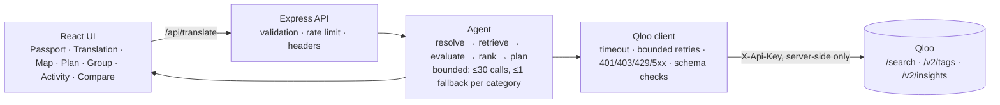

# TastePilot — your taste knows no borders

**Taste Translation for people moving to, or visiting, a city they don't know.** You tell TastePilot what you love (specific artists and films, genres, kinds of places, atmosphere). It resolves that through [Qloo](https://docs.qloo.com/)'s cultural-intelligence API and finds places in the destination city that connect to *your* taste, showing the evidence for each match and what is still unverified.

Built for the Qloo Agentic Hackathon (Oct 2026). MIT licensed.

## The problem
Maps and review apps rank places by popularity and proximity. Someone who loves indie music, quiet cafés and science-fiction films has no way to say "find me the Bengaluru version of my Chennai" — and an LLM answering from memory can't show where its suggestions come from.

## What it does
1. **Taste Passport**: source city (context), destination, specific favorites, genres, place categories, atmosphere, budget, stops, things to avoid, optional companions. A one-click **sample scenario** (made-up input, Chennai → Bengaluru) demos everything.
2. **Taste Translation agent** (bounded, ≤30 Qloo calls, traced): resolves favorites → Qloo entities; genres → Qloo tags → representative seed entities (only when you didn't name a favorite of that type); place categories → Qloo tag filters; then asks Qloo Insights for places in the destination steered by your signals, with explainability.
3. **Explainable recommendations**: each card shows Qloo's description, address, rating, price *level* (an indicator), weekly schedule (not live status), website, why it matched, constraint checks, and badges for source and evidence tier.
4. **Taste Translation Map**: *You said → Qloo resolved → In the destination*, with an equivalent text list.
5. **What-if refinement** with a "what changed" diff; **proposed plan** (labeled unverified, not route-optimized); **GroupTaste** (up to 2 companions); **Agent activity** timeline; **Compare** (Qloo with vs without your signals; no LLM involved).

## Provenance (what is what)
| Label | Meaning |
|---|---|
| Qloo data | returned by a Qloo API call (entities, affinity, explainability, hours, price level…) |
| Your input | what you typed or selected |
| App-derived | computed here from retrieved data: evidence tier, atmosphere keyword matches, ordering, plan, group coverage |
| LLM-generated | **none** is produced in the default flow; the UI says "none used" |
| DEV FIXTURE | synthetic data, only possible outside production with `ALLOW_DEV_MODE=1` |

Internal scores are never presented as Qloo scores. "Affinity" values are Qloo's own and are relative to the signals sent.

## Ranking (transparent)
Candidates are ordered by (1) coverage across people, (2) **evidence tier** — *signal-linked* (Qloo explainability names one of your signals) > *signal-ranked* (Qloo affinity but no link) > *category-only* (returned for the category with no signal, e.g. after a fallback), (3) Qloo affinity rounded to 2 decimals, (4) atmosphere keyword matches, (5) Qloo's result order. Near-duplicate branches ("Dolci - X" / "Dolci, Y") are collapsed and categories are interleaved for variety. Fallbacks and category-only results are flagged *low confidence*.

## Architecture

Files: `server/agent.ts` (workflow, ranking, plan), `server/qloo.ts` (client), `server/passport.ts` (schema + mapping), `server/app.ts` (routes, security), `client/src/App.tsx`, `client/src/graph.ts` (map data, shared by map and list).

## Qloo integration (verified against the live hackathon API on 2026-10-29)
| Endpoint | Used for |
|---|---|
| `GET /search` | resolve named favorites (no type filter; prefers artist/movie over person) |
| `GET /v2/tags` (`filter.query`) | resolve genres and place categories to tag URNs (`urn:tag:genre:music:*`, `urn:tag:category:place:*`) |
| `GET /v2/insights` | `filter.type`, `filter.tags`, `filter.location.query`, `signal.interests.entities`, `feature.explainability`; used for places, genre seeding, and group affinity |

Observed behaviours the code is built around: genre *tags* as signals give every place the **same affinity**, so genres are seeded with entities; `/search` on a genre word returns unrelated entities; tags like `japanese_food` can return 0 places while `japanese_restaurant` returns 20, so there is **one** traced fallback per category (next category tag, else the same tag without signals); combining two `filter.tags` behaves as OR, so it isn't used.

## Run
```bash
npm install
cp .env.example .env        # add QLOO_API_KEY (request one via the hackathon form)
set -a; . ./.env; set +a
npm run build && npm start  # http://localhost:8787
# dev: ALLOW_DEV_MODE=1 npm run dev   (fixtures; UI shows a DEV banner)
```
Environment variables: see `.env.example`. `ANTHROPIC_API_KEY`/`LLM_MODEL` are optional and only enable the text-planner parser and `POST /api/compare`; nothing in the main flow needs an LLM.

## Test
```bash
npm test                 # mocked/unit: Qloo client, agent, passport, map data, security, API
npm run test:live        # real Qloo calls; needs QLOO_API_KEY; kept separate on purpose
npm run typecheck
```
See `TEST_REPORT.md` for results and what is *not* covered. Browser journey: `e2e/README.md`.

## Deploy
Docker + Render blueprint included. See `DEPLOYMENT.md`.

## Privacy
No accounts and no database. Requests are processed in memory; logs contain Qloo status codes and paths only (no queries, no keys). The browser never sees the Qloo key.

## Limitations (honest)
- Opening hours are Qloo's **weekly schedule**, not live status; prices are Qloo **price levels**, not costs; no travel times, bookings or reviews. Plans are *Proposed, unverified*.
- Result quality is Qloo's: some categories are sparse (e.g. only one heritage building in Bengaluru), some places are loosely related (a hotel returned for "Japanese food"). Fallback results are flagged.
- Genre seeds can be weak (e.g. science-fiction movie seeds); naming a specific favorite is better, and favorites always win over seeds.
- Atmosphere uses fixed keyword lists over Qloo's text; it only nudges ordering.
- Named favorites are matched by Qloo search; check the match on the Map tab ("Radiohead (artist)"). Unmatched inputs are reported and ignored.
- The signal comparison measured one run (see `TEST_REPORT.md`); it shows how much signals change results, not that results are better. No LLM comparison was run (no LLM key).
- Hackathon-grade limiter (in-memory, per IP); not hardened for abuse.

## License
MIT (see `LICENSE`).
